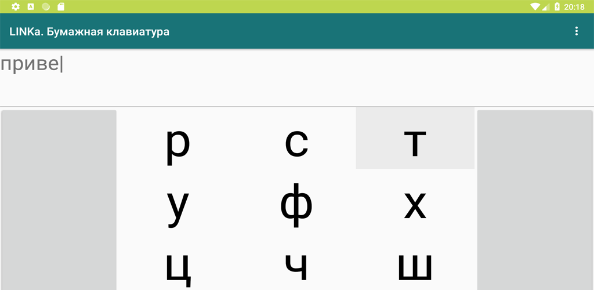

# LINKa. Paper Board

Android app and input method for composing text from a paged symbol grid. The app can speak composed text with Android TextToSpeech and can also be enabled as a system keyboard.



## Project

- Single Android application module: `:app`.
- Package and namespace: `su.linka.linkapaperboard`.
- Launcher UI entrypoint: `MainActivity`.
- Keyboard service entrypoint: `PaperboardIME`.
- Shared grid UI layout: `app/src/main/res/layout/keys.xml`.

## Requirements

- JDK 17.
- Android SDK with `compileSdk 36` installed.
- Use the checked-in Gradle wrapper: `./gradlew`.

## Build

```bash
./gradlew assembleDebug
```

Release bundle, matching CI:

```bash
./gradlew clean bundleRelease
```

Release signing is optional locally. To produce a signed release artifact, set:

```bash
ANDROID_KEYSTORE=/path/to/keystore
ANDROID_KEYSTORE_PASSWORD=...
ANDROID_KEY_ALIAS=...
ANDROID_KEY_PASSWORD=...
```

## Test And Lint

Run all local JVM unit tests:

```bash
./gradlew testDebugUnitTest
```

Run one test class:

```bash
./gradlew testDebugUnitTest --tests su.linka.linkapaperboard.CookieTest
```

Run debug lint:

```bash
./gradlew lintDebug
```

Verify that the merged release manifest and runtime contain neither Crashlytics nor AppMetrica:

```bash
./gradlew verifyPrivacyConfiguration
```

Run instrumented tests only with a connected device or emulator:

```bash
./gradlew connectedDebugAndroidTest
```

## Notes

- The selectable alphabet is localized via `@string/alphabet`; English and Russian alphabets intentionally differ.
- The space key is stored internally as `␣` and converted to a real space when a grid item is clicked.
- `Cookie` stores app preferences in SharedPreferences; tests that touch it should reset state with `Cookie.resetForTests(context)`.
- The first privacy notice is informational and can be deferred without disabling TTS or the input method. Crashlytics and AppMetrica are not included in the app.

## Лицензия

Собственный программный код LINKa в этом репозитории распространяется на условиях
GNU General Public License версии 3 или, по выбору получателя, любой более поздней
версии (SPDX: `GPL-3.0-or-later`). Полный неизменённый текст GPLv3: [LICENSE](LICENSE).

Разрешены использование, форки, изменения и коммерческое использование. При
распространении покрываемого GPL кода и производных программ необходимо соблюдать
GPL: сохранять уведомления об авторстве, лицензии и отсутствии гарантий, отмечать
изменения и их даты, предоставлять соответствующий исходный код получателям и
лицензировать покрываемую производную программу на условиях GPL. Личные изменения,
которые не распространяются, публиковать не требуется. Гарантии не предоставляются
в пределах разделов 15–16 GPLv3.

Авторы и правообладатели сохраняют права на свои вклады; существующие имена и годы
авторства сохраняются в исходниках, уведомлениях и истории Git. Поддержка или участие
АНО «Линка» сами по себе не означают передачу ей исключительных прав. Copyright FSF
в тексте GPL относится к тексту лицензии, а не к авторству программы. Ранее
предоставленные права на версии под MIT/BSD/ISC не отзываются.

Эта GPL-декларация относится только к собственному программному коду и не
перелицензирует сторонний код, SDK/DLL Tobii, Unity-компоненты, зависимости,
изображения, звуки, шрифты, бренды и учебные материалы. Их исходные лицензии,
атрибуция и ограничения сохраняются; права на товарные знаки не предоставляются.
Публичная доступность файла не заменяет разрешение правообладателя. Совместимость
всей готовой сборки с GPL и права на материалы без подтверждённой лицензии этим
изменением не устанавливаются.
